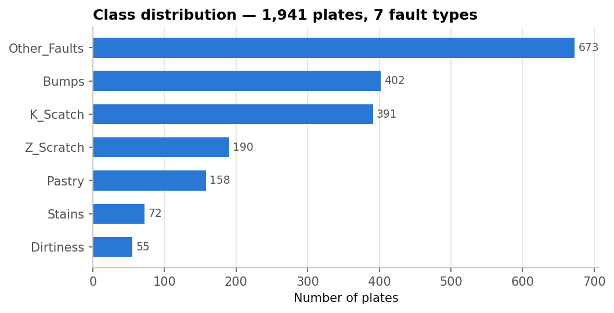
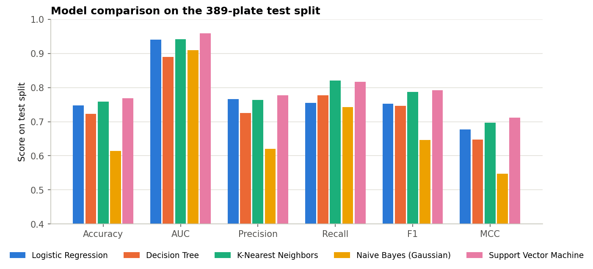
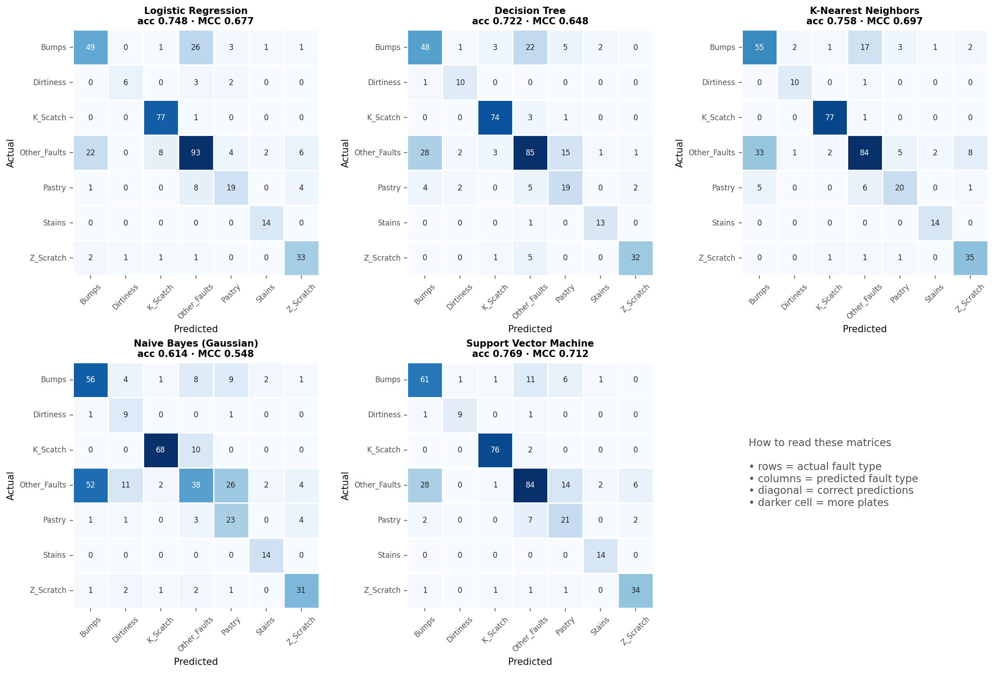

# 🔩 Steel Plate Fault Classifier

**BITS Pilani · Machine Learning · Assignment 2**: five classic classifiers trained on the UCI *Steel Plates Faults* dataset, compared on six metrics, and served through an interactive Streamlit app.

| | |
|---|---|
| **GitHub repository** | https://github.com/2026aj05725-piyush-mohapatra/steel-plate-fault-classifier |
| **Live Streamlit app** | https://steel-plate-fault-classifier.streamlit.app |

---

## a. Problem Statement

Steel plates leaving a rolling line are inspected for surface faults. Each detected fault region is described by 27 measurements (its position and bounding box, area and perimeters, brightness statistics, steel grade, plate thickness and several shape indices). The task is to **predict which of seven fault types a region belongs to**: Pastry, Z_Scratch, K_Scatch, Stains, Dirtiness, Bumps or Other_Faults.

This is a **multi-class classification** problem with **imbalanced classes** (the largest class is about 12 times the smallest). The goals of this project are to:

1. train Logistic Regression, Decision Tree, K-Nearest Neighbors, Gaussian Naive Bayes and a Support Vector Machine on the same data;
2. evaluate each on a held-out test split with Accuracy, AUC, Precision, Recall, F1 and the Matthews Correlation Coefficient (MCC);
3. explain the differences between the models and pick a winner;
4. deploy the saved models in a Streamlit app that scores uploaded test data without retraining.

Because the classes are imbalanced, precision, recall, F1 and AUC are **macro-averaged** (each fault type counts equally), and MCC is reported as a balanced single-number summary.

## b. Dataset Description

| Property | Value |
|---|---|
| Name / source | **Steel Plates Faults**, UCI Machine Learning Repository, dataset #198 |
| Creators | M. Buscema, S. Terzi, W. Tastle (Semeion Research Center), donated 2010 |
| Citation / licence | DOI [10.24432/C5J88N](https://doi.org/10.24432/C5J88N) · CC BY 4.0 |
| Instances | **1,941** (minimum required: 500) |
| Features | **27** numeric (minimum required: 12) |
| Target | `Fault_Type`, 7 classes (built from the 7 one-hot columns of the raw file) |
| Missing values / duplicates | none / none |
| Raw file in repo | `data/Faults.NNA` (original UCI file) → `data/steel_plates_faults.csv` (tidy) |

**Feature groups**

| Group | Features |
|---|---|
| Location & size (7) | X_Minimum, X_Maximum, Y_Minimum, Y_Maximum, Pixels_Areas, X_Perimeter, Y_Perimeter |
| Luminosity (4) | Sum_of_Luminosity, Minimum_of_Luminosity, Maximum_of_Luminosity, Luminosity_Index |
| Plate & process (4) | Length_of_Conveyer, TypeOfSteel_A300, TypeOfSteel_A400, Steel_Plate_Thickness |
| Shape indices (12) | Edges_Index, Empty_Index, Square_Index, Outside_X_Index, Edges_X_Index, Edges_Y_Index, Outside_Global_Index, LogOfAreas, Log_X_Index, Log_Y_Index, Orientation_Index, SigmoidOfAreas |

**Class distribution**

| Fault type | Plates | Share |
|---|---:|---:|
| Other_Faults | 673 | 34.7 % |
| Bumps | 402 | 20.7 % |
| K_Scatch | 391 | 20.1 % |
| Z_Scratch | 190 | 9.8 % |
| Pastry | 158 | 8.1 % |
| Stains | 72 | 3.7 % |
| Dirtiness | 55 | 2.8 % |

**Characteristics that shaped the modelling**

* **Imbalance**: Dirtiness and Stains together make up under 7 % of the data, which is why model selection uses macro-F1.
* **Heavy skew**: perimeter and area features are extremely right-skewed (skewness of Y_Perimeter ≈ 39, X_Perimeter ≈ 22), so the grid search tries both `StandardScaler` and a Yeo-Johnson `PowerTransformer`.
* **Redundancy**: 7 feature pairs have |r| > 0.9 (Y_Minimum/Y_Maximum and TypeOfSteel_A300/A400 are perfectly correlated; Pixels_Areas/Sum_of_Luminosity r = 0.98).
* **Split**: stratified 80 / 20 split with a fixed seed (1729) gives **1,552 training** and **389 test** plates. The test plates, with labels, are saved as [`test_data.csv`](test_data.csv).



## c. GitHub Repository Link

**https://github.com/2026aj05725-piyush-mohapatra/steel-plate-fault-classifier**

```
steel-plate-fault-classifier/
├── app.py                    # Streamlit app (loads saved models, never retrains)
├── fault_toolkit.py          # shared schema, model registry and metric functions
├── train_models.py           # full training pipeline (script)
├── model_training.ipynb      # same pipeline as a notebook (run on BITS Virtual Lab)
├── requirements.txt
├── README.md
├── test_data.csv             # 389 held-out plates: 27 features + Fault_Type
├── data/
│   ├── Faults.NNA            # original UCI file
│   └── steel_plates_faults.csv
├── model/                    # saved scikit-learn pipelines (scaler + classifier)
│   ├── logistic_regression.joblib
│   ├── decision_tree.joblib
│   ├── knn.joblib
│   ├── naive_bayes_gaussian.joblib
│   ├── svm_rbf.joblib
│   ├── model_card.json       # tuned params, CV scores, test metrics, library versions
│   └── test_metrics.csv
├── reports/figures/          # charts used in this README
└── .streamlit/config.toml    # app theme
```

## d. Models Used

All five models are scikit-learn `Pipeline`s, so the scaler is stored inside each `.joblib` file and no separate preprocessing artifact is needed. Hyper-parameters were chosen by **5-fold stratified grid search on the training split only**, scored by macro-F1. The test split was used once, for the final evaluation below.

| Model | Pipeline | Tuned hyper-parameters | CV macro-F1 |
|---|---|---|:---:|
| Logistic Regression | StandardScaler → LogisticRegression | C = 0.3, class_weight = None | 0.7133 |
| Decision Tree | DecisionTreeClassifier | criterion = entropy, max_depth = 10, min_samples_leaf = 1 | 0.7502 |
| K-Nearest Neighbors | StandardScaler → KNeighborsClassifier | k = 5, weights = distance, p = 1 (Manhattan) | 0.7536 |
| Naive Bayes (Gaussian) | StandardScaler → GaussianNB | var_smoothing = 1e-6 | 0.6330 |
| Support Vector Machine | StandardScaler → SVC (RBF) | C = 10, gamma = 0.1, class_weight = balanced | 0.7724 |

### Comparison table: evaluation on the test split (389 plates, macro-averaged)

<!-- METRICS:START -->
| ML Model Name | Accuracy | AUC | Precision | Recall | F1 | MCC |
|---|:---:|:---:|:---:|:---:|:---:|:---:|
| Logistic Regression | 0.7481 | 0.9406 | 0.7659 | 0.7555 | 0.7529 | 0.6771 |
| Decision Tree | 0.7224 | 0.8894 | 0.7253 | 0.7778 | 0.7468 | 0.6481 |
| K-Nearest Neighbors | 0.7584 | 0.9424 | 0.7641 | **0.8205** | 0.7874 | 0.6967 |
| Naive Bayes (Gaussian) | 0.6144 | 0.9101 | 0.6202 | 0.7425 | 0.6459 | 0.5479 |
| Support Vector Machine | **0.7686** | **0.9589** | **0.7776** | 0.8170 | **0.7920** | **0.7117** |
<!-- METRICS:END -->

*Bold = best in column. AUC is one-vs-rest ROC-AUC averaged over the 7 classes. The same numbers appear in the app when `test_data.csv` is scored.*





### Observations on model performance

| ML Model Name | Observation about model performance |
|---|---|
| **Logistic Regression** | A solid linear baseline: accuracy 0.748, AUC 0.941, MCC 0.677 (3rd overall). Training accuracy (0.723) is close to test accuracy, so it is not overfitting; it is limited by its linear decision boundaries. It separates the distinctive classes almost perfectly (K_Scatch recall 0.99, Stains 1.00) but struggles where classes overlap: 26 Bumps were labelled Other_Faults and 22 the other way round, and only 6 of 11 Dirtiness plates were found. Its AUC is much higher than its accuracy, so its probabilities rank classes well even when the top guess is wrong. |
| **Decision Tree** | Lowest AUC (0.889) because a single tree outputs coarse, almost 0/1 probabilities, and accuracy 0.722. Training accuracy is 0.925 against 0.722 on test, the clearest overfitting of the five even with depth capped at 10. Its axis-aligned rules suit some classes: best Z_Scratch F1 (0.877) and 10 of 11 Dirtiness plates found. It is the least stable on Pastry (F1 0.528), sending 15 Other_Faults plates there. Its main strength is that the rules are easy to read. |
| **KNN** | Second best: F1 0.787, MCC 0.697, and the **highest macro recall (0.821)**. Standardisation is essential (raw Y_Minimum runs to about 1.3 × 10⁷), and the search chose Manhattan distance with distance weighting, which makes training accuracy 1.00 by construction. It has the best Pastry F1 (0.656). It keeps the whole training set (the largest model file, about 200 KB) and still mixes up the two broad classes: 33 Other_Faults plates were predicted as Bumps. |
| **Naive Bayes** | Clearly the weakest: accuracy 0.614, F1 0.646, MCC 0.548. Its independence assumption is broken by this data: 7 feature pairs have \|r\| > 0.9 (two pairs are perfectly correlated), so the same evidence is counted twice, and the heavily skewed features are far from Gaussian. It over-predicts the small classes: Other_Faults recall collapses to 0.28 (52 sent to Bumps, 26 to Pastry), which inflates its macro recall (0.743) relative to its precision (0.620). AUC is still 0.910, so its probability ranking is reasonable. It is fast and simple, but not competitive here. |
| **Support Vector Machine** | **Best model**: top Accuracy (0.769), AUC (0.959), Precision (0.778), F1 (0.792) and MCC (0.712), and also the best cross-validation score (0.772), so the choice is consistent and not a lucky split. The RBF kernel captures non-linear class boundaries, and `class_weight = balanced` lifts the rare classes (Dirtiness F1 0.857, every Stains plate found). It also has the best Bumps F1 (0.701). The remaining errors are mostly Other_Faults predicted as Bumps or Pastry. |
| **Overall, winner for this dataset?** | **Support Vector Machine (RBF, C = 10, γ = 0.1, balanced class weights).** It wins 5 of the 6 metrics, and KNN edges it only on recall (0.821 vs 0.817). The ranking by F1 and MCC is SVM > KNN > Logistic Regression > Decision Tree > Naive Bayes. Every model's hardest boundary is between *Other_Faults* and *Bumps*/*Pastry*: Other_Faults is a catch-all for unrelated defects, so it overlaps every specific class. Well-defined faults are recognised by every model: K_Scatch and Stains with F1 ≥ 0.87, and Z_Scratch with F1 between 0.80 and 0.88. |

## Streamlit App

**Live app:** https://steel-plate-fault-classifier.streamlit.app

| Required feature | How the app does it |
|---|---|
| Dataset upload (CSV) | Sidebar uploader for **test data**. It needs the 27 features and `Fault_Type`; the 7 original one-hot columns are also accepted. A *Download sample test_data.csv* button gives evaluators a ready file, and the bundled test split is scored by default. |
| Model selection dropdown | Sidebar selector for the five saved models (★ marks the best on the test split). |
| Evaluation metrics | Six metric cards (Accuracy, AUC, Precision, Recall, F1, MCC), each with its difference from the five-model average, plus a macro/weighted averaging switch. |
| Confusion matrix / classification report | Heatmap (counts or row-normalised), per-class classification report and the three most frequent mix-ups. |
| Extras | *Compare all models* tab (table, chart, winner), *Predictions* tab (confidence, runner-up class, misclassified filter, CSV download), *About* tab (dataset, run details, library-version check). A warning appears if an upload contains rows from the training split. |

The app **only loads** the saved pipelines from `model/` (`joblib.load`) and calls `predict` / `predict_proba`. Nothing is retrained on the uploaded data.

## How to Run

```bash
pip install -r requirements.txt

# 1. (optional) retrain: rebuilds test_data.csv, model/*.joblib, figures and the table above
python train_models.py            # or run model_training.ipynb top to bottom

# 2. launch the app
streamlit run app.py
```

* Training takes about 3 minutes on 2 CPU cores, mostly the SVM grid search.
* Tested with Python 3.10 and 3.13; `requirements.txt` resolves to pre-built wheels on Python 3.10–3.14.
* `scikit-learn` is pinned to the exact version that wrote the `.joblib` files, because unpickling with a different version is the most common cause of deployment failures. `train_models.py` re-pins it automatically if you retrain with another version.

## Acknowledgements

Dataset: Buscema, M., Terzi, S., & Tastle, W. (2010). *Steel Plates Faults* [Dataset]. UCI Machine Learning Repository. https://doi.org/10.24432/C5J88N
